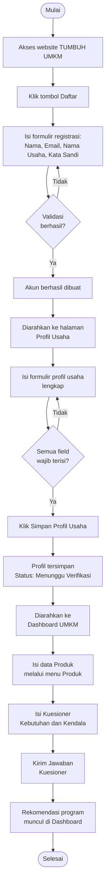
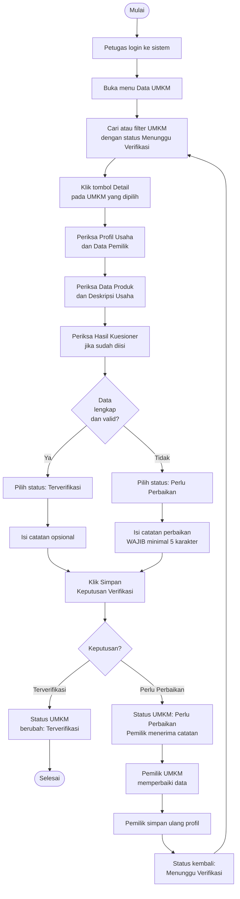
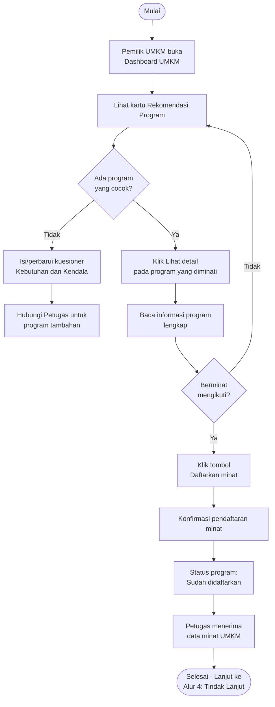
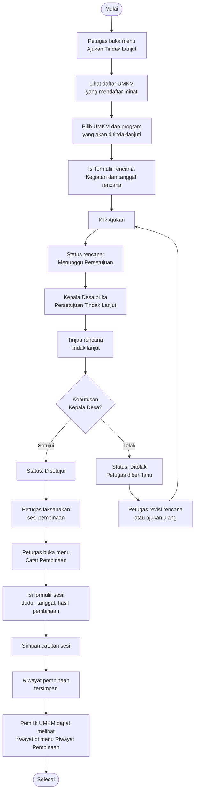
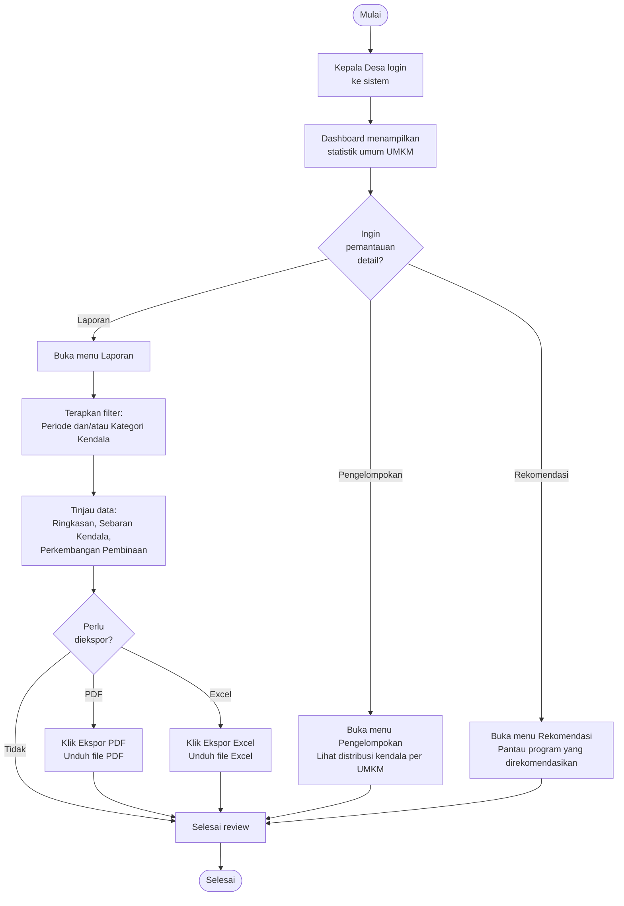
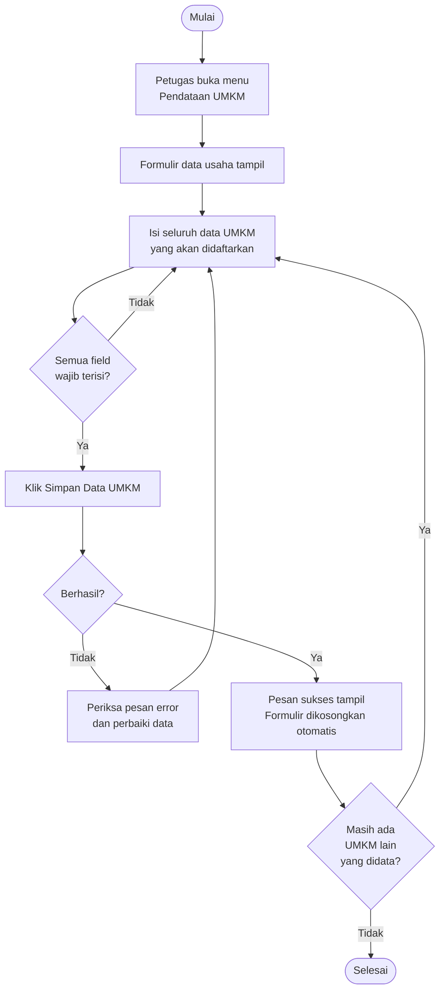

# BAB V — PANDUAN ALUR PENGGUNAAN

[← BAB IV](./04_Panduan_Penggunaan.md) | [Lanjut: BAB VI →](./06_Penanganan_Masalah.md)

---

## Pengantar

Bab ini menjelaskan alur penggunaan sistem TUMBUH UMKM berdasarkan skenario nyata yang melibatkan beberapa pengguna secara berurutan. Setiap alur digambarkan dengan diagram *flowchart* untuk mempermudah pemahaman.

---

## 5.1 Alur 1: Pendaftaran dan Pengisian Data UMKM

**Tujuan Alur**  
Pemilik UMKM berhasil mendaftarkan akun, melengkapi profil usaha, mengisi produk, dan kuesioner kebutuhan sehingga mendapatkan rekomendasi program bantuan.

**Pengguna yang Terlibat**  
Pemilik UMKM

**Persyaratan Awal**  
- Pemilik UMKM belum memiliki akun di sistem
- Pemilik UMKM memiliki email aktif dan nomor telepon

**Urutan Proses**

**Hasil Akhir**  
Pemilik UMKM memiliki profil usaha yang terisi lengkap, daftar produk, dan rekomendasi program bantuan yang sesuai dengan kendala usaha.

---

## 5.2 Alur 2: Verifikasi Data UMKM oleh Petugas

**Tujuan Alur**  
Petugas Desa melakukan verifikasi data profil UMKM yang sudah didaftarkan oleh pemilik usaha.

**Pengguna yang Terlibat**  
- Pemilik UMKM (mengirimkan data)
- Petugas Desa (memverifikasi)

**Persyaratan Awal**  
- Pemilik UMKM sudah mengisi dan menyimpan profil usaha
- Status profil: "Menunggu Verifikasi"

**Urutan Proses**

**Hasil Akhir**  
Data UMKM berhasil diverifikasi dan status diperbarui. Jika "Perlu Perbaikan", pemilik memperbaiki data dan siklus verifikasi berulang.

---

## 5.3 Alur 3: Rekomendasi dan Pendaftaran Minat Program Bantuan

**Tujuan Alur**  
UMKM mendapatkan rekomendasi program bantuan dan mendaftarkan minat untuk mengikuti program tersebut.

**Pengguna yang Terlibat**  
- Pemilik UMKM
- Petugas Desa (mengelola program)

**Persyaratan Awal**  
- UMKM sudah mengisi kuesioner kebutuhan dan kendala
- Petugas sudah menginput program bantuan yang terkait dengan kategori kendala

**Urutan Proses**

**Hasil Akhir**  
Pemilik UMKM berhasil mendaftarkan minat pada program bantuan dan data tersedia bagi Petugas untuk ditindaklanjuti.

---

## 5.4 Alur 4: Tindak Lanjut dan Pembinaan UMKM

**Tujuan Alur**  
Petugas Desa membuat rencana tindak lanjut pembinaan, mendapatkan persetujuan Kepala Desa, dan mencatat hasil pelaksanaan pembinaan.

**Pengguna yang Terlibat**  
- Petugas Desa
- Kepala Desa
- Pemilik UMKM (penerima pembinaan)

**Persyaratan Awal**  
- UMKM sudah mendaftarkan minat pada program bantuan
- Petugas memiliki akses ke menu Ajukan Tindak Lanjut

**Urutan Proses**

**Hasil Akhir**  
Sesi pembinaan terlaksana dan terdokumentasi dalam sistem. Pemilik UMKM dapat melihat riwayat pembinaan yang telah diikuti.

---

## 5.5 Alur 5: Pemantauan dan Pelaporan oleh Kepala Desa

**Tujuan Alur**  
Kepala Desa memantau kondisi UMKM secara keseluruhan dan mengunduh laporan untuk keperluan pelaporan atau pengambilan keputusan.

**Pengguna yang Terlibat**  
Kepala Desa

**Persyaratan Awal**  
- Kepala Desa memiliki akun dan sudah login
- Sudah ada data UMKM yang terisi di sistem

**Urutan Proses**

**Hasil Akhir**  
Kepala Desa mendapatkan gambaran lengkap kondisi UMKM dan memiliki dokumen laporan untuk referensi.

---

## 5.6 Alur 6: Pendataan UMKM oleh Petugas (UMKM tanpa Akun)

**Tujuan Alur**  
Petugas Desa mendata UMKM yang pemiliknya belum memiliki akun di sistem.

**Pengguna yang Terlibat**  
Petugas Desa

**Persyaratan Awal**  
- Petugas sudah login ke sistem
- Data UMKM yang akan didata sudah tersedia (formulir fisik atau wawancara langsung)

**Urutan Proses**

**Hasil Akhir**  
Data UMKM berhasil tersimpan di sistem dan dapat ditemukan di halaman Data UMKM untuk proses verifikasi selanjutnya.

---

[← BAB IV](./04_Panduan_Penggunaan.md) | [Lanjut: BAB VI →](./06_Penanganan_Masalah.md)
