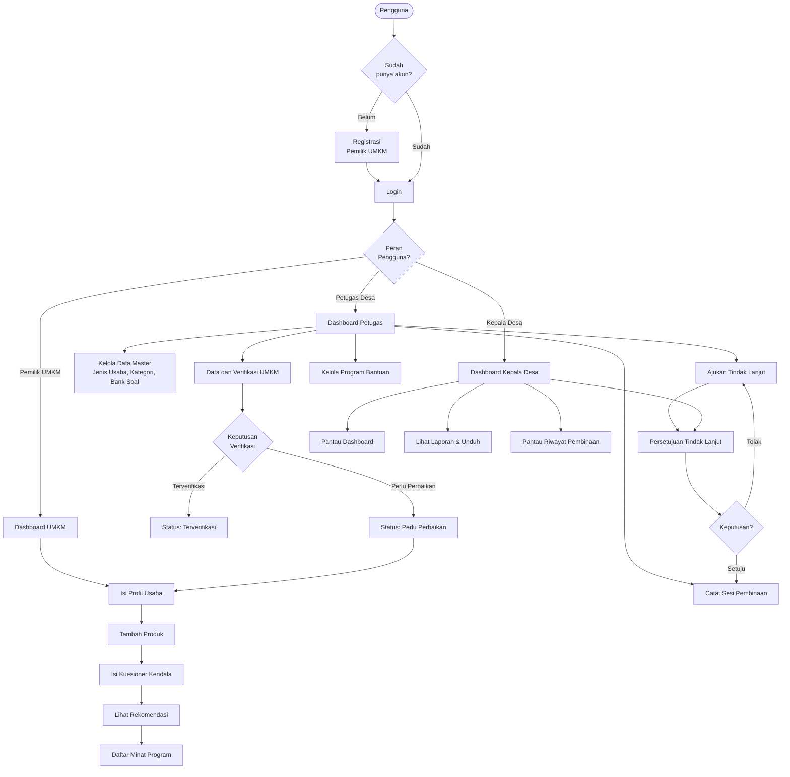

# LAMPIRAN

[← BAB VII](./07_Penutup.md) | [Kembali ke README](./README.md)

---

## Lampiran A — Glosarium Istilah

Berikut adalah daftar istilah yang digunakan dalam sistem TUMBUH UMKM beserta penjelasannya:

| Istilah | Penjelasan |
|---------|-----------|
| **Akun** | Profil pengguna yang digunakan untuk mengakses sistem TUMBUH UMKM, terdiri dari email/username dan kata sandi. |
| **Asesmen** | Proses penilaian kebutuhan dan kendala UMKM melalui pengisian kuesioner yang terstruktur. |
| **Bank Soal** | Kumpulan pertanyaan yang dikelola oleh Petugas Desa dan digunakan dalam kuesioner kebutuhan dan kendala. |
| **Dashboard** | Halaman ringkasan yang menampilkan statistik dan informasi kondisi sistem secara sekilas. |
| **Draf** | Status program bantuan yang belum dipublikasikan dan belum dapat direkomendasikan ke UMKM. |
| **Google OAuth** | Mekanisme login menggunakan akun Google tanpa perlu membuat kata sandi baru. |
| **Jenis Usaha** | Kategori usaha yang dikelola petugas sebagai pilihan saat mendaftarkan profil UMKM (misalnya: Kuliner, Kerajinan, Jasa, dll.). |
| **Kategori Kendala** | Bidang permasalahan usaha yang menjadi dasar penilaian kuesioner (misalnya: Modal, Pemasaran, Digitalisasi, Legalitas, Produksi). |
| **Kepala Desa** | Peran pengguna dengan akses pemantauan menyeluruh dan wewenang persetujuan tindak lanjut. |
| **Kendala Utama** | Kategori kendala dengan skor tertinggi dari hasil kuesioner yang diisi UMKM. |
| **Kuesioner** | Formulir pertanyaan terstruktur yang diisi UMKM untuk mengidentifikasi kebutuhan dan kendala usaha. |
| **Laravel** | Framework PHP yang digunakan untuk membangun backend sistem TUMBUH UMKM. |
| **Login** | Proses masuk ke sistem menggunakan email dan kata sandi. |
| **Logout** | Proses keluar dari sistem dan mengakhiri sesi aktif. |
| **Mode Officer** | Mode formulir profil usaha yang digunakan oleh Petugas Desa saat mendata UMKM tanpa akun. |
| **Pemilik UMKM** | Peran pengguna yang mendaftarkan dan mengelola data usahanya sendiri. |
| **Pendataan UMKM** | Proses Petugas Desa memasukkan data UMKM yang pemiliknya belum memiliki akun. |
| **Pengelompokan** | Pengelompokan UMKM berdasarkan kategori kendala utama yang teridentifikasi dari kuesioner. |
| **Perlu Perbaikan** | Status verifikasi yang diberikan petugas ketika data UMKM perlu diperbaiki oleh pemilik. |
| **Petugas Desa** | Peran pengguna yang mengelola data UMKM, verifikasi, program bantuan, dan pembinaan. |
| **PHP** | Bahasa pemrograman server-side yang digunakan untuk membangun backend sistem. |
| **Program Bantuan** | Program atau kegiatan yang diselenggarakan oleh lembaga tertentu untuk membantu UMKM mengatasi kendala. |
| **Program Rekomendasi** | Program bantuan yang dicocokkan secara otomatis dengan kendala UMKM berdasarkan hasil kuesioner. |
| **React.js** | Library JavaScript yang digunakan untuk membangun komponen antarmuka yang dinamis dan interaktif. |
| **Registrasi** | Proses pendaftaran akun baru di sistem TUMBUH UMKM. |
| **Reset Kata Sandi** | Proses memperbarui kata sandi yang terlupakan melalui tautan yang dikirim ke email. |
| **Riwayat Pembinaan** | Catatan sesi-sesi pembinaan yang telah dilaksanakan untuk UMKM tertentu. |
| **Role** | Peran pengguna dalam sistem yang menentukan fitur apa yang dapat diakses (Pemilik UMKM, Petugas Desa, Kepala Desa). |
| **Sesi Pembinaan** | Satu kegiatan pembinaan yang dicatat petugas setelah tindak lanjut disetujui dan dilaksanakan. |
| **Sidebar** | Panel navigasi di sisi kiri halaman yang berisi menu-menu sesuai peran pengguna. |
| **Skala Likert** | Jenis pertanyaan kuesioner dengan pilihan angka (misalnya 1-5) yang menunjukkan tingkat intensitas. |
| **SQLite** | Sistem manajemen basis data ringan yang digunakan oleh sistem TUMBUH UMKM. |
| **Status Verifikasi** | Kondisi data profil UMKM: Menunggu Verifikasi, Terverifikasi, atau Perlu Perbaikan. |
| **Tailwind CSS** | Framework CSS yang digunakan untuk membangun tampilan antarmuka sistem. |
| **Terverifikasi** | Status verifikasi yang menunjukkan bahwa data UMKM sudah valid dan disetujui oleh petugas. |
| **Tindak Lanjut** | Rencana kegiatan pembinaan yang diajukan petugas kepada kepala desa untuk mendapatkan persetujuan. |
| **Toggle** | Tombol sakelar untuk mengaktifkan atau menonaktifkan suatu item (misalnya jenis usaha, kategori kendala). |
| **UMKM** | Usaha Mikro, Kecil, dan Menengah — usaha produktif milik perorangan atau badan usaha dengan kriteria tertentu. |
| **Verifikasi** | Proses pemeriksaan dan validasi data profil UMKM yang dilakukan oleh Petugas Desa. |

---

## Lampiran B — Daftar Menu dan Fungsi

### B.1 Menu Pemilik UMKM

| No. | Grup Menu | Label Menu | URL | Fungsi |
|-----|----------|-----------|-----|--------|
| 1 | UTAMA | Dashboard | /umkm/dashboard | Ringkasan status usaha dan rekomendasi program |
| 2 | USAHA | Profil Usaha | /umkm/profil | Mendaftarkan/memperbarui data identitas usaha |
| 3 | USAHA | Produk | /umkm/produk | Mengelola daftar produk/jasa yang dijual |
| 4 | USAHA | Kebutuhan dan Kendala | /umkm/kebutuhan | Mengisi kuesioner asesmen kebutuhan usaha |
| 5 | HASIL | Rekomendasi Program | /umkm/rekomendasi | Melihat dan mendaftarkan minat program bantuan |
| 6 | HASIL | Riwayat Pembinaan | /umkm/riwayat-pembinaan | Memantau riwayat sesi pembinaan |
| 7 | AKUN | Profil Akun | /akun | Memperbarui data akun dan kata sandi |
| — | — | Keluar | POST /logout | Logout dari sistem |

### B.2 Menu Petugas Desa

| No. | Grup Menu | Label Menu | URL | Fungsi |
|-----|----------|-----------|-----|--------|
| 1 | UTAMA | Dashboard | /dashboard | Statistik kondisi UMKM desa |
| 2 | PENGELOLAAN | Data UMKM | /petugas/umkm | Melihat daftar dan status UMKM |
| 3 | PENGELOLAAN | Pendataan UMKM | /petugas/umkm/pendataan-umkm | Mendata UMKM tanpa akun |
| 4 | PENGELOLAAN | Jenis Usaha | /petugas/jenis-usaha | Mengelola kategori/jenis usaha |
| 5 | PENGELOLAAN | Kategori Kendala | /petugas/kategori-kendala | Mengelola kategori kendala usaha |
| 6 | PENGELOLAAN | Bank Soal | /petugas/bank-soal | Mengelola pertanyaan kuesioner |
| 7 | PENGELOLAAN | Program Bantuan | /petugas/program-bantuan | Mengelola data program bantuan |
| 8 | TINDAK LANJUT | Ajukan Tindak Lanjut | /petugas/tindak-lanjut | Mengajukan rencana pembinaan |
| 9 | TINDAK LANJUT | Riwayat Pembinaan | /petugas/catat-pembinaan | Mencatat dan melihat sesi pembinaan |
| 10 | ANALISIS | Pengelompokan | /petugas/pengelompokan | Melihat pengelompokan UMKM |
| 11 | ANALISIS | Rekomendasi | /petugas/rekomendasi | Memantau hasil rekomendasi program |
| 12 | ANALISIS | Laporan | /petugas/laporan | Laporan ringkasan dan ekspor PDF/Excel |
| 13 | AKUN | Profil Akun | /akun | Memperbarui data akun dan kata sandi |
| — | — | Keluar | POST /logout | Logout dari sistem |

### B.3 Menu Kepala Desa

| No. | Grup Menu | Label Menu | URL | Fungsi |
|-----|----------|-----------|-----|--------|
| 1 | UTAMA | Dashboard | /dashboard | Statistik kondisi UMKM desa |
| 2 | PEMANTAUAN | Data UMKM | — | Dalam pengembangan (tidak dapat diklik) |
| 3 | PEMANTAUAN | Pengelompokan | /pimpinan/pengelompokan | Melihat pengelompokan UMKM |
| 4 | PEMANTAUAN | Rekomendasi | /pimpinan/rekomendasi | Memantau distribusi rekomendasi program |
| 5 | PEMANTAUAN | Laporan | /pimpinan/laporan | Laporan ringkasan dan ekspor PDF/Excel |
| 6 | KEPUTUSAN | Persetujuan Tindak Lanjut | /pimpinan/persetujuan-tindak-lanjut | Menyetujui/menolak rencana pembinaan |
| 7 | KEPUTUSAN | Riwayat Pembinaan | /pimpinan/riwayat-pembinaan | Memantau seluruh riwayat pembinaan |
| 8 | AKUN | Profil Akun | /akun | Memperbarui data akun dan kata sandi |
| — | — | Keluar | POST /logout | Logout dari sistem |

---

## Lampiran C — Matriks Hak Akses Pengguna

### Tabel 8: Matriks Hak Akses Pengguna

| Fitur / Halaman | Pemilik UMKM | Petugas Desa | Kepala Desa | Tamu (Publik) |
|----------------|:---:|:---:|:---:|:---:|
| **Halaman Landing** | ✅ | ✅ | ✅ | ✅ |
| **Login** | ✅ | ✅ | ✅ | ✅ |
| **Registrasi** | ✅ | ❌ | ❌ | ✅ |
| **Lupa/Reset Kata Sandi** | ✅ | ✅ | ✅ | ✅ |
| **Login dengan Google** | ✅ | ❌ | ❌ | ✅ |
| **Dashboard UMKM** | ✅ | ❌ | ❌ | ❌ |
| **Profil Usaha (sendiri)** | ✅ | ❌ | ❌ | ❌ |
| **Produk** | ✅ | ❌ | ❌ | ❌ |
| **Kebutuhan & Kendala** | ✅ | ❌ | ❌ | ❌ |
| **Rekomendasi Program (UMKM)** | ✅ | ❌ | ❌ | ❌ |
| **Riwayat Pembinaan (UMKM)** | ✅ | ❌ | ❌ | ❌ |
| **Profil Akun** | ✅ | ✅ | ✅ | ❌ |
| **Dashboard Petugas/Pimpinan** | ❌ | ✅ | ✅ | ❌ |
| **Data UMKM (verifikasi)** | ❌ | ✅ | ❌ | ❌ |
| **Detail UMKM (petugas)** | ❌ | ✅ | ❌ | ❌ |
| **Verifikasi UMKM** | ❌ | ✅ | ❌ | ❌ |
| **Pendataan UMKM (petugas)** | ❌ | ✅ | ❌ | ❌ |
| **Jenis Usaha** | ❌ | ✅ | ❌ | ❌ |
| **Kategori Kendala** | ❌ | ✅ | ❌ | ❌ |
| **Bank Soal** | ❌ | ✅ | ❌ | ❌ |
| **Program Bantuan (kelola)** | ❌ | ✅ | ❌ | ❌ |
| **Ajukan Tindak Lanjut** | ❌ | ✅ | ❌ | ❌ |
| **Catat Pembinaan** | ❌ | ✅ | ❌ | ❌ |
| **Pengelompokan UMKM** | ❌ | ✅ | ✅ | ❌ |
| **Rekomendasi (pantau)** | ❌ | ✅ | ✅ | ❌ |
| **Laporan (PDF/Excel)** | ❌ | ✅ | ✅ | ❌ |
| **Persetujuan Tindak Lanjut** | ❌ | ❌ | ✅ | ❌ |
| **Riwayat Pembinaan (pantau)** | ❌ | ❌ | ✅ | ❌ |

**Keterangan:** ✅ = Dapat Akses | ❌ = Tidak Dapat Akses

---

## Lampiran D — Diagram Alur Sistem

### D.1 Diagram Alur Sistem Keseluruhan

---

## Lampiran E — Informasi Teknis

### E.1 Struktur Database Utama

| Tabel | Fungsi |
|-------|--------|
| `users` | Data akun pengguna (email, kata sandi, peran, status aktif) |
| `businesses` | Data profil usaha UMKM |
| `business_types` | Jenis/kategori usaha |
| `products` | Data produk yang dijual UMKM |
| `obstacle_categories` | Kategori kendala usaha |
| `assessment_questions` | Pertanyaan bank soal |
| `question_options` | Pilihan jawaban untuk setiap pertanyaan |
| `assessments` | Rekaman pengisian kuesioner UMKM |
| `assessment_answers` | Jawaban per pertanyaan dalam kuesioner |
| `assessment_category_scores` | Skor per kategori dari kuesioner |
| `assistance_programs` | Data program bantuan |
| `program_recommendations` | Hasil pencocokan program dengan UMKM |
| `follow_ups` | Rencana tindak lanjut pembinaan |
| `coaching_sessions` | Catatan sesi pembinaan |
| `social_accounts` | Akun sosial (Google) yang terhubung |

### E.2 Peran Pengguna dalam Kode

| Label di Antarmuka | Nilai dalam Sistem |
|-------------------|-------------------|
| Pemilik UMKM | `business_owner` |
| Petugas Desa | `officer` |
| Kepala Desa | `village_head` |

### E.3 Status Verifikasi UMKM

| Label di Antarmuka | Nilai dalam Sistem | Keterangan |
|-------------------|-------------------|-----------|
| Menunggu Verifikasi | `pending` | Status default setelah mengisi/memperbarui profil |
| Terverifikasi | `verified` | Data disetujui oleh petugas |
| Perlu Perbaikan | `needs_revision` | Data perlu diperbaiki oleh pemilik |

### E.4 Status Program Bantuan

| Label di Antarmuka | Nilai dalam Sistem |
|-------------------|-------------------|
| Aktif | `active` |
| Draf | `draft` |
| Ditutup | `closed` |
| Diarsipkan | `archived` |

---

## Lampiran F — Daftar File Dokumentasi

Buku panduan ini terdiri dari file-file berikut:

| No. | File | Deskripsi | Status |
|-----|------|-----------|--------|
| 1 | `README.md` | Halaman indeks dan navigasi buku panduan | ✅ Selesai |
| 2 | `00_Halaman_Awal.md` | Halaman sampul, identitas dokumen, kata pengantar, daftar isi | ✅ Selesai |
| 3 | `01_Pendahuluan.md` | Latar belakang, tujuan, manfaat, ruang lingkup, sasaran | ✅ Selesai |
| 4 | `02_Pengenalan_Website.md` | Gambaran umum, teknologi, pengguna, navigasi | ✅ Selesai |
| 5 | `03_Persiapan_Penggunaan.md` | Spesifikasi perangkat, browser, cara akses | ✅ Selesai |
| 6 | `04_Panduan_Penggunaan.md` | Panduan lengkap per fitur untuk setiap peran | ✅ Selesai |
| 7 | `05_Alur_Penggunaan.md` | Alur penggunaan dengan diagram flowchart | ✅ Selesai |
| 8 | `06_Penanganan_Masalah.md` | Tabel permasalahan dan solusi | ✅ Selesai |
| 9 | `07_Penutup.md` | Kesimpulan, saran, dan informasi kontak | ✅ Selesai |
| 10 | `08_Lampiran.md` | Glosarium, daftar menu, matriks hak akses, diagram, info teknis | ✅ Selesai |
| 11 | `assets/` | Folder untuk screenshot dan aset gambar | 📋 Tersedia (screenshot belum tersedia) |

> [!NOTE]
> Screenshot aktual halaman website belum tersedia dalam dokumentasi ini karena keterbatasan akses visual saat proses dokumentasi dibuat. Untuk melengkapi dokumentasi dengan screenshot, jalankan website, ambil screenshot setiap halaman, dan simpan di folder `buku-panduan/assets/` dengan penamaan yang sesuai (misalnya: `01-halaman-login.png`, `02-dashboard-umkm.png`, dst.).

---

[← BAB VII](./07_Penutup.md) | [Kembali ke README](./README.md)
